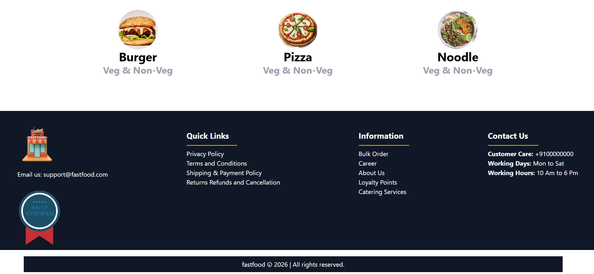

<h1 align="center"> Snack House App </h1>
FastFood is a responsive food website built using HTML5 and Tailwind CSS. It features a clean, modern layout, a well-structured meals section, and a detailed footer.

<h2> Features</h2>

<ul>
<li>Responsive Layout — Adapts the website layout for mobile and desktop screens.</li>
<li>Navigation Bar — Includes Home, About Us, Contact Us, and Login/Signup sections.</li>
<li>Meals Section — Displays different food items, including burgers, pizzas, and noodles.</li>
<li>Food Categories — Showcases vegetarian and non-vegetarian options for different meals.</li>
<li>Desktop and Mobile Banners — Uses different banner images for desktop and mobile layouts.</li>
<li>Footer Section — Provides quick links, company information, and contact details.</li>
<li>Contact Information — Displays customer care details and working hours.</li>
<li>Tailwind CSS Styling — Uses utility classes to create a clean and modern website layout.</li>
</ul>

<h2>Technologies Used</h2>

<ul>
<li>HTML5 — Used to structure the website content and sections.</li>
<li>Tailwind CSS — Used to style the website with utility classes and create a responsive layout.</li>
</ul>

<h2> Screenshots</h2>

  

  
